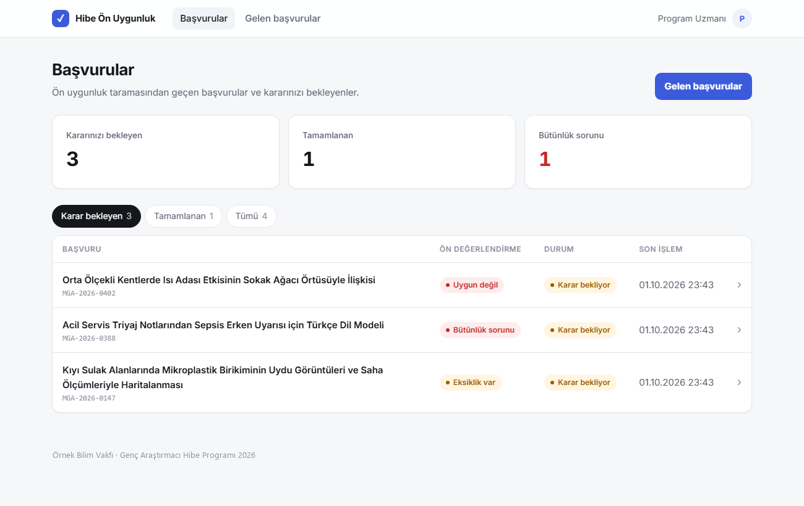
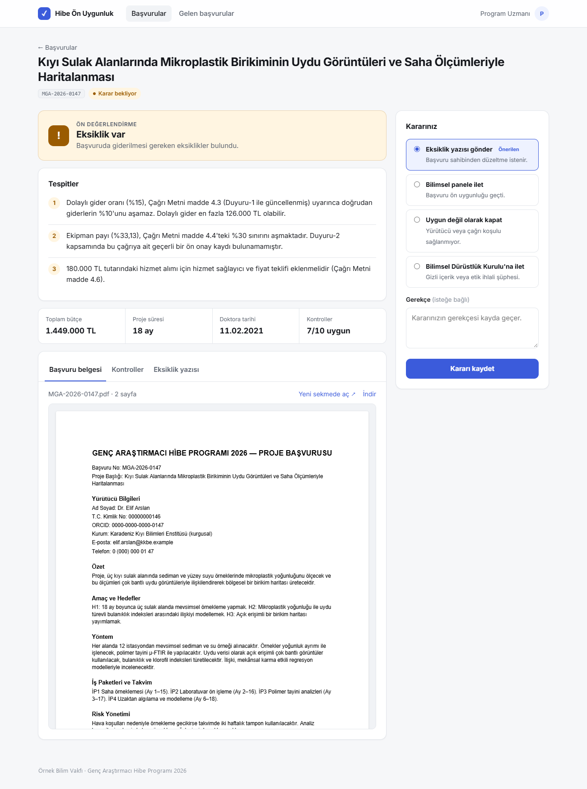

# Azure'da Agentic Hibe Başvurusu Ön Taraması

**Microsoft Azure üzerinde agentic yapay zekâ sistemleri kurmayı** uçtan uca öğreten uygulamalı bir proje. Kurgusal bir araştırma vakfı, hibe başvurularını bilimsel panele göndermeden önce bir ön uygunluk taramasından geçiriyor.

> Sayılar koddan, yorum modelden, keşif agent'tan, karar insandan gelir.

Akışın omurgası deterministik: checkpoint ve insan onayı içeren bir **Microsoft Agent Framework workflow**. Model bilgilerin yerini bulur ve alıntılar. Kod her alıntıyı doğrular ve bütün hesapları yapar. Bütçeli ve salt okunur iki **agent** yalnızca kural kitabının kapsamadığı durumlarda çalışır. Nihai kararı, Entra ID ile korunan web arayüzünde bir **program uzmanı** verir.





## Sonuçlar

Golden set üzerinde 3 deneme × 6 başvuru ile ölçüldü ([`docs/eval_report_v3.md`](docs/eval_report_v3.md)):

| Ölçüt | Sonuç |
|---|---|
| Nihai karar doğru | 18/18 |
| Eksiklik şablonları birebir doğru | 18/18 |
| Kural sonucu doğru | 153/153 |
| Modele sızan kimlik bilgisi | 0 |
| Yakalanan prompt injection varyantı (red team) | 7/7 |
| Başvuru başına maliyet | ≈ 0,008 $ (erken çıkış 0,0017 $) |
| Bütün ortamın sabit aylık maliyeti | ≈ 0 $ |

## Neyi gösteriyor?

- **Rakamlar hiçbir zaman modelden gelmez.** Bütçe tutarları Document Intelligence tablo hücrelerinden okunur. Tarih, süre ve sayılar doğrulanmış alıntılardan kodla çıkarılır.
- **Erken çıkış kapısı, kör tarama ve sürümlü kaynaklar.** Arama, yürürlük tarihine göre filtrelenen hybrid aramadır.
- **Üç katmanlı injection savunması:** görünmez metin tespiti, paragraf bazında Prompt Shields ve PDF meta veri kontrolü. Bütün dedektörler atlatılsa bile karar kodda kalır.
- **Bütçeli, salt okunur agent'lar.** Kanıtlarını kod doğrular. Bir LLM denetçi, gerektiğinde tek bir düzeltme turu başlatır. Foundry Agent Service'te barındırma demosu da var.
- **Gerçek hata bulan değerlendirme:** Çoklu deneme, yanlış bir reddi ve kaçan bir riski ortaya çıkardı. İkisi de düzeltildi ve testlerle korunuyor.
- **Geri bildirim döngüsü:** Uzmanın onayladığı agent bulguları kural kitabı v3'te kurala dönüştü. Agent çalıştırmaları aynı doğrulukla 6'dan 0'a indi, maliyet yaklaşık %25 düştü.

## Azure servisleri

Microsoft Foundry · Azure OpenAI (gpt-5.4-mini, text-embedding-3-small) · Foundry Agent Service · Microsoft Agent Framework · Azure AI Search (Free) · Document Intelligence (F0) · AI Content Safety Prompt Shields (F0) · Azure AI Language (F0) · Application Insights · Cosmos DB (serverless) · Blob Storage · Key Vault · App Service (F1) + Easy Auth · Managed Identity · Bicep.

## Hızlı başlangıç

Ortam kuruluysa arayüzü tek komut açar. Bir başvuru PDF'i yükleyin (örnekler `scenario/upload_samples/` içinde), incelemeyi canlı izleyin ve kararınızı verin:

```bash
python scripts/ui.py          # http://127.0.0.1:8000
```

İlk kurulum:

```bash
python -m venv .venv && .venv/Scripts/pip install -r requirements.txt
pytest                                   # 145 çevrimdışı test, Azure gerekmez

az login
az group create -n rg-grant-screening-dev -l swedencentral
export DEVELOPER_PRINCIPAL_ID=$(az ad signed-in-user show --query id -o tsv)
az deployment group create -g rg-grant-screening-dev -n main -f infra/main.bicep -p infra/main.bicepparam
python scripts/write_env.py && python scripts/smoke_test.py
python scripts/build_pdfs.py && python scripts/build_search_index.py
python scripts/ui.py
```

Ayrıntılı rehber: **[docs/REHBER.md](docs/REHBER.md)**.

## Klasör yapısı

| Yol | İçerik |
|---|---|
| `docs/REHBER.md` | Rehber: kavramlar, mimari, bütün Azure servisleri, ölçümler, maliyet, kurulum |
| `docs/lessons/` | Her faz için bir ders notu (00–11) |
| `docs/architecture.md` | Mimari, bir başvurunun adım adım yolculuğu, kullanılan bütün araç ve teknikler |
| `docs/eval_report_v2.md`, `docs/eval_report_v3.md` | Üretilmiş değerlendirme raporları |
| `infra/` | Bütün Azure kaynakları için Bicep |
| `src/grant_screening/` | Pipeline: intake, structure, rules, llm_stages, agents, search, workflow |
| `webapp/` | Program uzmanı arayüzü (FastAPI + Jinja2). Yerel modda taramalar canlı çalışır; bulut modu App Service'te Entra girişiyle |
| `scripts/` | Giriş noktaları: tarama, workflow, red team, dağıtım, geri bildirim |
| `eval/` | Golden set değerlendirmesi ve Foundry değerlendiricileri |
| `scenario/` | Tamamen kurgusal çağrı belgeleri, kural kitapları v2/v3, sicil, şablonlar, başvurular, beklenen sonuçlar |
| `tests/` | Kayıtlı servis çıktılarıyla çevrimdışı testler |

## Uyarı

Bu repodaki bütün kurumlar, kişiler, kimlik numaraları ve belgeler kurgusaldır. Kimlik ve telefon numaraları bilerek geçersiz biçimdedir. Fiyatlar ve servis sınırları Ekim 2026'da doğrulanmıştır ve zamanla değişebilir.
