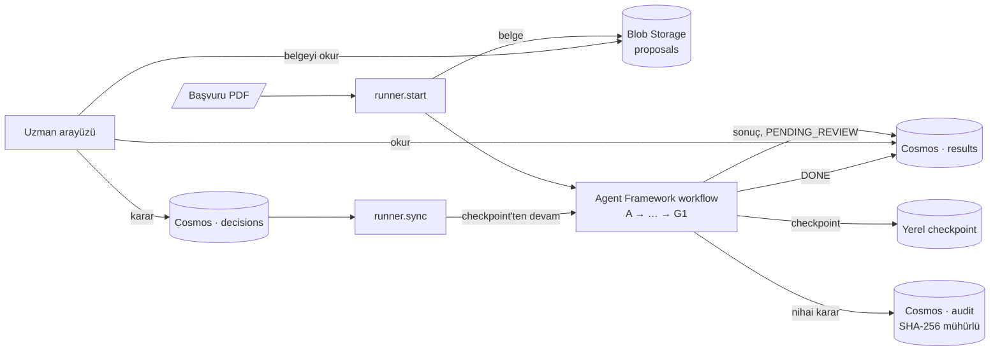

# Mimari — Hibe Başvurusu Ön Uygunluk Taraması

> Ayrıntılı anlatım, ölçümler ve kurulum: [REHBER.md](REHBER.md). Bu belge mimarinin kısa ve referans niteliğindeki özetidir.

## İlke

> **Sayılar koddan, yorum modelden, keşif agent'tan, karar insandan gelir.**

## Aşamalar

| Aşama | Tür | Modül | Ne yapar |
|---|---|---|---|
| A1 Layout | Servis + kod | `intake/layout.py` | Bölümler, bütçe tablosu (bölünen tabloları birleştirir) |
| A2 Bütünlük | Kod + servis | `intake/hidden_text.py`, `intake/integrity.py` | Gizli metin; görünür paragraflarda ve meta veride Prompt Shields |
| A3 Kör tarama | Servis + kod | `intake/pii.py` | Kimlik → takma ad; eşleme yalnızca yerelde |
| B1 Çıkarım | LLM | `structure/extract.py` | Bilgilerin yerini bulur, birebir alıntılar |
| B2 Doğrulama | Kod | `structure/extract.py` | Alıntıyı doğrular, değeri alıntıdan okur, izinleri sayar |
| C Kural kapısı | Kod | `rules/engine.py` | Tarih, sayı, oran, bölüm kuralları; erken çıkış; asimetrik güven |
| C Anlamsal kurallar (v3) | Kod ön koşul + LLM | `rules/semantic.py` | Ön koşul kodla; gereklilik alıntılı tek çağrıyla |
| D1 İstisnalar | Kod | `rules/exceptions.py` | Ön onay sicili; iddiaların triyajı |
| D2 Kayıt Araştırmacı | Agent | `agents/runner.py` | Kodun çözemediği iddialar; 3 araç çağrısı |
| E1 Açık risk | LLM ×2 örnek | `llm_stages/open_risk.py` | Kural kitabının kapsamadığı maddeler (kapsam kodla hesaplanır) |
| E2 Soruşturmacı | Agent | `agents/runner.py` | İşaretli riski doğrular veya çürütür; 5 araç çağrısı |
| F1 Atıf | Kod | `rules/citations.py`, `agents/runner.py` | Alıntı kaynağında var mı; kural kaynağı yürürlükte mi |
| F2 Denetçi | LLM | `llm_stages/claim_support.py` | Kanıt sonucu destekliyor mu; desteklemiyorsa 1 düzeltme turu |
| F3 Karar | Kod | `rules/decision.py` | Kural kitabındaki karar sırası |
| G1 Eksiklik yazısı | Kod + LLM çerçeve | `llm_stages/letter.py` | Şablon kilidi: model sayı yazamaz |
| G2 İnsan | Arayüz | `webapp/app.py` | Program Uzmanı kararı |
| H Denetim ve geri bildirim | Kod | `audit.py`, `scripts/feedback_report.py` | Mühürlü kayıt → kural kitabı adayları |

Destek modülleri:

| Modül | Görev |
|---|---|
| `search/index.py` | AI Search hybrid arama (BM25 + vektör + semantic ranker, yürürlük filtresi); agent'ların `search_call_docs` aracı |
| `corpus.py` | Çağrı metni ve duyuruları yürürlük tarihli parçalara böler (arama indeksi, atıf kontrolü) |
| `agents/tools.py` | Salt okunur, katı şemalı agent araçları; bütçe ve denetim middleware'i |
| `agents/hosted.py` | Soruşturmacı'nın Foundry Agent Service'te barındırılan sürümü (demo) |
| `llm.py`, `cache.py` | Structured output çağrıları; `(aşama, model, prompt sürümü, girdi)` anahtarlı önbellek |
| `telemetry.py` | OpenTelemetry → Application Insights (prompt içeriği yazılmaz) |
| `rules/engine.py` → `describe()` | Her kural sonucu için uzmanın okuyacağı tek satırlık özet (kural kitabındaki `title` ve `display_unit` alanlarından) |

Kural kitabı, tarama tarihinde yürürlükte olan en yüksek sürümdür (`GRANT_RULEBOOK` ile sabitlenebilir). Workflow durumu sürüm numarasını taşır.

## Orkestrasyon ve çalışma zamanı

| Bileşen | Görev |
|---|---|
| `screening.py` | Aşama fonksiyonları. Testler ve değerlendirme bunları sırayla çağırır |
| `workflow/graph.py` | Aynı aşamalar Agent Framework grafiği olarak: koşullu kenar (erken çıkış), paralel D2 ve E, checkpoint, `request_info` ile insan onayı |
| `workflow/runner.py` | `start` (belgeyi yükler, akışı canlı olaylarla çalıştırır, uzman adımında durur), `resume`, `sync`. CLI ve yerel arayüz bunu ortak kullanır |

**Depolar:**

| Depo | İçerik | Kim yazar / okur |
|---|---|---|
| Cosmos `results` | Başvurunun son hali: öneri, tespit cümleleri, kural özetleri, kanıtlar, eksiklik yazısı, gizli metin alıntısı | Pipeline yazar, arayüz okur |
| Cosmos `decisions` | Uzman kararları (durum: NEW → APPLIED / STALE / FAILED) | Arayüz yazar, `sync` okur |
| Cosmos `audit` | Değişmez karar kaydı: kurallar, kanıtlar, araç çağrıları, sürümler, uzman | Pipeline yazar |
| Cosmos `submissions` | Yüklenen başvurular: numara, dosya adı, sayfa, SHA-256, yükleyen, durum (NEW → PROCESSING → SCREENED / FAILED) | Arayüz yazar, pipeline günceller |
| Blob `proposals` | Gönderilen PDF'ler | Pipeline yazar, arayüz okur |
| Yerel `.cache/` | Servis ve model önbelleği, checkpoint'ler, kimlik eşlemesi | Yalnızca pipeline |
| Yerel `data/uploads/` | Yerel modda yüklenen PDF'lerin kopyası (Blob'a erişilemeyen ağlarda da çalışır) | Arayüz yazar, pipeline okur |

## Program Uzmanı arayüzü

Tek kod tabanı (`webapp/`, FastAPI + Jinja2), iki mod:

| | Yerel (`python scripts/ui.py`) | Bulut (App Service F1) |
|---|---|---|
| Başvurular, detay, belge görüntüleyici | ✅ | ✅ |
| Belge yükleme (Gelen başvurular) | ✅ | ✅ |
| İncelemeyi başlatma + canlı ilerleme (SSE) | ✅ | - (`run_workflow.py process-inbox` işler) |
| Uzman kararı | Hemen uygulanır | `decisions`'a yazılır, `sync` uygular |

Yerel modda inceleme web sunucusunun olay döngüsünde değil, **kendi iş parçacığında ve olay döngüsünde** çalışır; olaylar `call_soon_threadsafe` ile SSE kuyruğuna aktarılır. (İlk sürümde inceleme sunucunun döngüsünde çalışıyordu; senkron SDK çağrıları sırasında arayüz tamamen donuyor, ilerleme penceresi hiç güncellenmiyordu.) Yüklemede de Blob/Cosmos çağrıları iş parçacığında yapılır.

Ekran uzmanın dilinde konuşur: tek cümlelik öneri, başvuru sahibine gidecek cümlelerle tespitler, okunur kural özetleri, PDF.js ile çizilen belge, karar formu. Maliyet, model çağrısı ve aşama kodları gösterilmez. Öneriden farklı karar gerekçe ister; onay/düzeltme ayrımını sistem çıkarır.

## Güvenlik

| Konu | Önlem |
|---|---|
| Kimlik doğrulama | Easy Auth + Entra ID, yalnızca atanmış kullanıcılar; `/healthz` dışındaki her yol korumalı |
| Servis erişimi | Anahtar yok: managed identity (bulut) ve `az login` (yerel); bütün servislerde yerel kimlik doğrulama kapalı |
| Sır | Tek sır (Easy Auth istemci sırrı) Key Vault'ta; uygulama Key Vault referansıyla okur |
| Başvuru içeriği | Saldırgan verisi sayılır: Jinja2 otomatik kaçışlama (XSS), PDF sunumunda `nosniff` ve `frame-ancestors 'self'` |
| İstek sahteciliği | Durum değiştiren POST'larda köken kontrolü (CSRF) |
| Belge yükleme | İçerik doğrulaması (PDF imzası, ayrıştırma, şifre, boyut, sayfa), SHA-256 ile tekrar engeli, yalnızca giriş yapmış uzmanlar. Gerçek kullanımda Microsoft Defender for Storage ile zararlı yazılım taraması önerilir |
| Belge deposu | Paylaşılan anahtar ve genel erişim kapalı; arayüzde yalnızca okuma rolü; başvuru kimliği desenle doğrulanır |
| Checkpoint | Yalnızca izin listesindeki türler geri yüklenir |

## Bir başvurunun yolculuğu: adım adım

**Senaryo:** *Kıyı Sulak Alanlarında Mikroplastik Birikimi* başlıklı başvuru (MGA-2026-0147) vakfa ulaşıyor. Kural kitabı v3. Aşağıdaki değerler sistemin gerçek çalıştırmasından alınmıştır.

### 0. Başvuru gelir
Program Uzmanı **Gelen başvurular** ekranında PDF'i yükler, sonra "İncelemeyi başlat"a basar.
- **Yükleme doğrulaması:** Dosya adına değil içeriğe bakılır: PDF imzası, **pypdf** ile açılabilirlik, şifreleme, en fazla 10 MB ve 30 sayfa. Aynı belge **SHA-256** özetinden tanınır ve ikinci kez kabul edilmez.
- Sistem başvuru numarası verir (ör. MGA-2026-5001). Kayıt Cosmos `submissions` kapsayıcısına yazılır.
- **FastAPI** isteği alır. `workflow/runner.py` incelemeyi başlatır.
- PDF, **Azure Blob Storage**'a yüklenir. Kimlik doğrulama **Microsoft Entra ID** ile yapılır, paylaşılan anahtar yoktur.
- **Microsoft Agent Framework Workflows** grafiği çalışmaya başlar. Her adımdan sonra **FileCheckpointStorage** ile durum kaydedilir.
- Ekrandaki ilerleme listesi **Server-Sent Events (SSE)** ile canlı güncellenir.

### 1. Belge okunur (A1)
- **Azure AI Document Intelligence**, `prebuilt-layout` modeliyle iki sayfayı okur. Bölümleri ve 7 satır × 3 sütunluk bütçe tablosunu çıkarır. F0 her istekte yalnızca 2 sayfa analiz ettiği için daha uzun belgeler **pypdf** ile parçalara bölünüp birleştirilir.
- Kod, sayfa sonunda bölünen tabloları birleştirir. Başlıkları numara öneki ve Türkçe büyük-küçük harf farkı olmadan, kural kitabındaki adlar ve `section_aliases` ile eşleştirir. Bütçe sütunlarını başlıktan (Kalem, Tutar) bulur. Diğer tablolar "Etiket: değer" satırları olarak metne girer.
- Formdaki başvuru numarası okunur; eksiklik yazısı bu numarayı kullanır.
- Sonuç, içerik özetine dayalı bir önbelleğe (SHA-256) yazılır. Aynı PDF ikinci kez okunmaz.

### 2. Güvenlik kontrolü (A2)
- **pdfplumber**, PDF'teki her karakterin rengine, boyutuna ve konumuna bakar. Beyaz, mikro punto veya sayfa dışı metin arar.
- Görünür 17 paragraf tek tek **Azure AI Content Safety Prompt Shields**'e gönderilir. Bu servis belgeye gömülü talimatları (prompt injection) arar.
- **pypdf**, PDF meta verisini okur. Meta veri de Prompt Shields'e gönderilir.
- **Sonuç:** Bu başvuruda temiz.

### 3. Kör tarama (A3)
- **Azure AI Language** (PII tespiti) kişi adı ve e-postayı bulur.
- Düzenli ifadeler T.C. kimlik, ORCID ve telefonu bulur.
- 6 kimlik bilgisi `[KISI_1]`, `[ORCID_1]` gibi takma adlarla değiştirilir.
- Gerçek değerler yalnızca yerel diskte kalır. Modele hiçbir zaman gitmez.

### 4. Bilgiler çıkarılır (B)
- **Microsoft Foundry** projesindeki **Azure OpenAI gpt-5.4-mini** modeli **Responses API**'ye **Structured Outputs** ile çağrılır. Şema **Pydantic** ile tanımlı.
- Model değerleri değil, değerlerin **yerini** döndürür: paragraf kimliği ve birebir alıntı. Örneğin `P18: "Doktora derecesi alış tarihi: 11.02.2021"`.
- Kod alıntının belgede geçtiğini doğrular. Değeri alıntıdan kendisi okur: 11.02.2021, 18 ay, 1.449.000 TL.
- Model üç istisna iddiası da bulur:
  - "çağrı metninin 4.3 maddesi uyarınca"
  - "Ön Onay No: ON-2025-031"
  - "Duyuru-2 kapsamında"

### 5. Kurallar uygulanır (C)
Python kural motoru, YAML formatındaki kural kitabını uygular. Yüzdeler tablo hücrelerinden hesaplanır.

| Kontrol | Sonuç |
|---|---|
| Yürütücü uygunluğu | Doktora 11.02.2021 · son tarih 11.02.2028 → uygun |
| Dolaylı gider oranı | 189.000 / 1.260.000 = **%15** · üst sınır %10 → **karşılanmıyor** |
| Ekipman payı | 480.000 / 1.449.000 = **%33,13** · üst sınır %30 → istisna kontrolüne |
| Bütçe toplamı | Tablo 1.449.000 = beyan 1.449.000 → uygun |
| Zorunlu bölümler | 8/8 → uygun |

### 6. İstisnalar çözülür (D1)
- Ön onay sicili, gerçek ORCID ile **sorgulanır**. Arama veya agent kullanılmaz.
- ON-2025-031 bir önceki çağrıya (MGA-2025) aittir. Duyuru-2 ön onayların yalnızca kendi çağrısında geçerli olduğunu söyler, bu yüzden ön onay **geçersiz** sayılır.
- "4.3" ve "Duyuru-2" atıfları zaten bir kod kuralının konusu. Agent'a gerek kalmaz.

### 7. Anlamsal kurallar (C, kural kitabı v3)
- **R-BUD-05:** Kod ön koşulu kontrol eder: hizmet alımı satırı 180.000 TL, yani 100.000 TL'den fazla. Bu yüzden gpt-5.4-mini'ye alıntı zorunlu tek bir soru sorulur: "Sağlayıcı ve teklif var mı?" Cevap üç doğrulanmış alıntıyla **karşılanmıyor**: bütçe satırı, "laboratuvar seçimi proje başladıktan sonra yapılacaktır" ifadesi ve "Ekler: Özgeçmiş".
- **R-ETH-01:** Projede insan kaynaklı veri yok. Kural uygulanmaz.

### 8. Kapsam dışı risk taraması (D2 ve E, paralel)
- Workflow iki **paralel dala** ayrılır (fan-out) ve sonra birleşir (fan-in).
- **D2:** Agent'a gidecek iddia yok.
- **E1:** Kural kitabının kapsamadığı çağrı maddeleri (2.3, 4.2, 6.1) kodla hesaplanır. gpt-5.4-mini bunları **iki bağımsız örnekle** tarar (self-consistency). Sonuç: işaret yok, bu yüzden agent çalışmaz.

> **Kural kitabı v2'de aynı başvuru:** O sürümde 4.6 (hizmet alımı) için bir kod kuralı yoktu.
> 1. E1 riski işaretler.
> 2. **Soruşturmacı agent** devreye girer. Agent, **Microsoft Agent Framework** `Agent` sınıfı ve **FoundryChatClient** ile çalışır.
> 3. Agent, katı şemalı **function calling** araçlarını çağırır: `get_budget_line`, `list_attachments`, `find_term` ve `search_call_docs`. Sonuncusu **Azure AI Search** üzerinde hybrid arama yapar: BM25 + vektör (**text-embedding-3-small**, HNSW) + **RRF** + **semantic ranker** + yürürlük filtresi.
> 4. Bütçe 5 araç çağrısıdır ve bir **middleware** ile uygulanır.
> 5. Agent CONFIRMED kararını üç alıntıyla verir. Kod alıntıları doğrular (F1).
> 6. İkinci bir model, **LLM-as-judge** olarak, kanıtın sonucu destekleyip desteklemediğini değerlendirir (F2). Desteklemezse agent denetçinin notuyla bir kez düzeltme yapar (**critic / reflection loop**).
>
> Aynı Soruşturmacı, **Foundry Agent Service**'te sürümlü bir *prompt agent* olarak da barındırılabilir: `agents/hosted.py`.

### 9. Doğrulama ve karar (F1, F3)
- Her kuralın dayandığı çağrı maddesinin son başvuru tarihinde yürürlükte olduğu kodla kontrol edilir.
- Karar motoru sabit sırayı uygular: istisnasız HIGH aykırılık var, sonuç **OFFICER_REVIEW**. Ekranda bu "Eksiklik var" olarak görünür.

### 10. Eksiklik yazısı (G1)
- Kod, onaylı şablonlardan üç cümle üretir, örneğin "Dolaylı gider oranı (%15) … en fazla 126.000 TL olabilir."
- gpt-5.4-mini yalnızca yazının çerçevesini yazar ve cümlelerin yerine `{{T1}}…{{T3}}` jetonlarını koyar.
- Kod çerçevede hiç rakam olmadığını kontrol eder (**şablon kilidi**), sonra cümleleri yerleştirir.
- Yazıya yalnızca başvuranın gerçek eksiklikleri girer. Sistemin okuyamadığı şeyler (UNRESOLVED, aşama sorunları) uzmana "Uzman kontrolü gerekli" olarak gösterilir. **INTEGRITY_REVIEW** kararında yazı hiç üretilmez.

### 11. Uzman kararı (G2, human-in-the-loop)
- Workflow `request_info` ile **durur**. Sonuç **Azure Cosmos DB**'ye (serverless) "Karar bekliyor" olarak yazılır.
- Uzman ekranda üç şey görür: tespitleri, okunur kontrolleri ve **PDF.js** ile çizilen başvuru belgesini. Belge Blob Storage'dan gelir.
- Uzman önerilen "Eksiklik yazısı gönder" kararını seçer.
- Karar Cosmos'taki `decisions` kapsayıcısına yazılır. `runner.sync` akışı **checkpoint'ten devam** ettirir. Bu adım günler sonra ve başka bir süreçte olabilir.
- Nihai kayıt **SHA-256** ile mühürlenip Cosmos `audit` kapsayıcısına yazılır. Kayıtta kurallar, kanıtlar, kural kitabı ve prompt sürümleri ile uzmanın adı bulunur.

### 12. Arka planda
- **İzleme:** Her aşama bir **OpenTelemetry** span'i üretir ve **Application Insights**'a gider. Agent Framework model ve araç span'lerini kendiliğinden ekler. Prompt içeriği izlere yazılmaz.
- **Geri bildirim:** `feedback_report.py`, denetim kayıtlarından uzmanca onaylanan agent bulgularını toplar. Bu bulgular kural kitabının bir sonraki sürümüne aday olur. v3 böyle doğdu.

### Diğer başvurular farklı yollardan geçer

| Başvuru | Farklılık |
|---|---|
| **Sepsis (0388)** | A2'de pdfplumber beyaz 1 puntoluk bir satır bulur, Prompt Shields satırı saldırı olarak işaretler. Sonuç **Bütünlük sorunu** olur ve gizli cümle ekranda alıntılanır. Document Intelligence görünmez metni okumadığı için bu satır modele hiç ulaşmaz. Tablonun kendi "Toplam" satırı yanlıştır, yalnızca kod toplaması yakalar. |
| **Kentsel ısı (0402)** | Yürütücü 7 yıllık sınırın dışında. Workflow **koşullu kenarla** doğrudan karara geçer (erken çıkış). D2, E ve F hiç çalışmaz, yazı yalnızca kodla üretilir. |
| **Buğday (0213)** | "2 adet" ebeveyn izni kodla sayılır, 36 ay uzatma uygulanır. ON-2026-012 ön onayı geçerlidir. Sonuç **Uygun**, workflow uzmanı beklemeden tamamlanır. |

## Kullanılan araçlar ve teknikler

### Azure servisleri

| Araç | Bu projedeki rolü |
|---|---|
| **Microsoft Foundry** (eski adı Azure AI Foundry) | Model dağıtımları, proje, agent'lar, değerlendirmeler |
| **Azure OpenAI · gpt-5.4-mini** | Çıkarım, anlamsal kurallar, risk taraması, denetçi, yazı çerçevesi, agent'lar |
| **Azure OpenAI · text-embedding-3-small** | Arama vektörleri |
| **Foundry Agent Service** | Soruşturmacı'nın barındırılan, sürümlü prompt agent hali |
| **Foundry Evaluations** | Görev uyumu, araç çağrısı doğruluğu, niyet çözümü değerlendiricileri |
| **Azure AI Document Intelligence** (Layout) | PDF'ten bölüm ve tablo çıkarımı |
| **Azure AI Content Safety · Prompt Shields** | Belge içi prompt injection tespiti |
| **Azure AI Language** (PII) | Kişisel veri tespiti, kör tarama |
| **Azure AI Search** (Free) | Hybrid arama: BM25, HNSW vektör, RRF, semantic ranker, OData yürürlük filtresi, `tr.microsoft` analizörü |
| **Azure Cosmos DB** (serverless) | Sonuçlar, uzman kararları, denetim kaydı |
| **Azure Blob Storage** | Başvuru PDF'leri |
| **Azure Key Vault** | Easy Auth istemci sırrı (Key Vault referansı) |
| **Azure App Service** (F1) + **Easy Auth** | Uzman arayüzü ve Entra ID girişi |
| **Microsoft Entra ID**, **Managed Identity**, **RBAC** | Anahtarsız kimlik doğrulama ve yetkilendirme |
| **Application Insights** + **Log Analytics** | İzleme (OpenTelemetry) |
| **Azure Monitor OpenTelemetry Distro** | İzlerin Application Insights'a gönderimi |
| **Bicep** | Bütün altyapının kodu (IaC) |
| **Cost Management Budgets**, **Azure Retail Prices API** | Bütçe uyarısı ve fiyat bilgisi |

### Çerçeveler ve kütüphaneler

| Araç | Rolü |
|---|---|
| **Microsoft Agent Framework** (Python 1.19) | `Agent`, `FoundryChatClient`, `FoundryAgent`, function tools, middleware, `WorkflowBuilder`, `Executor`, koşullu kenar, fan-out/fan-in, `FileCheckpointStorage`, `request_info` (insan onayı), `WorkflowViz` |
| **azure-ai-projects**, **openai** SDK | Foundry proje istemcisi, Responses API |
| **Pydantic** | Structured output şemaları, katı araç şemaları |
| **pdfplumber**, **pypdf**, **reportlab** | Gizli metin tespiti, meta veri, sentetik PDF üretimi |
| **FastAPI**, **Jinja2**, **SSE** | Uzman arayüzü, otomatik HTML kaçışlama, canlı ilerleme |
| **PDF.js** | Tarayıcıda PDF çizimi (kendi sunucumuzdan) |
| **pytest**, **Playwright** | Çevrimdışı testler, gerçek tarayıcıyla arayüz doğrulaması |

> **LangGraph kullanılmadı.** Graf tabanlı agent orkestrasyonu için Microsoft'un eşdeğeri olan **Microsoft Agent Framework Workflows** seçildi. Foundry ile doğrudan entegre, OpenTelemetry yerleşik ve Semantic Kernel ile AutoGen'in halefi. Kavramlar birebir eşleşir:
>
> | LangGraph | Microsoft Agent Framework |
> |---|---|
> | `StateGraph`, node | `WorkflowBuilder`, `Executor` |
> | `add_conditional_edges` | `add_edge(..., condition=...)` |
> | paralel dallar ve birleşme | `add_fan_in_edges` |
> | checkpointer | `FileCheckpointStorage` |
> | `interrupt` (insan onayı) | `ctx.request_info` + `@response_handler` |
> | tool node / `bind_tools` | function tools + middleware |

### Teknikler

| Teknik | Nerede |
|---|---|
| **Deterministik omurga + seçici agent kullanımı** | Workflow; agent'lar yalnızca D2 ve E2'de |
| **Tool / function calling** | Soruşturmacı ve Kayıt Araştırmacı |
| **Structured outputs** | Bütün model çağrıları |
| **Alıntı zorunlu çıkarım** (grounded extraction) | B1: model yer bulur, kod okur |
| **Hybrid retrieval** (BM25 + vektör + RRF + reranker) | AI Search, agent arama aracı |
| **Yürürlük tarihli belge sürümleme** | Çağrı metni, duyurular, kural kitabı |
| **Self-consistency** (çoklu örnek) | E1 açık risk taraması, 2 örnek |
| **LLM-as-judge** | F2 iddia desteği, Foundry değerlendiricileri |
| **Critic / reflection loop** | Desteklenmeyen agent sonucu için tek düzeltme turu |
| **Human-in-the-loop** | Workflow `request_info`, uzman arayüzü |
| **Checkpointing** | Süreçler arası devam |
| **Prompt injection savunması** (derinlemesine savunma) | Görünürlük, Prompt Shields, meta veri, veri bloğu, kararın kodda olması |
| **Takma adlandırma** (pseudonymization) | Kör tarama |
| **Şablon kilidi** | Eksiklik yazısı |
| **Asimetrik güven** | Modelin bir şeyi kaçırması yalnızca insana gönderir |
| **İçerik özetli önbellek** | Servis ve model çağrıları |
| **Golden set değerlendirmesi**, **çoklu deneme** | `eval/run_eval.py` |
| **Red teaming** | 7 injection varyantı + derinlemesine savunma testi |
| **Infrastructure as Code**, **anahtarsız mimari** | Bicep, Entra ID, managed identity |

## Karar sırası (kural kitabı)

1. Bütünlük bayrağı → **INTEGRITY_REVIEW**
2. Uygunluk kapısı başarısız → **INELIGIBLE** (erken çıkış)
3. Aşama hatası (ör. okunamayan sayfa veya bütçe), belirsiz kural veya doğrulanamayan agent sonucu → **OFFICER_REVIEW**; bu maddeler eksiklik yazısına girmez
4. İstisnasız HIGH aykırılık → **OFFICER_REVIEW**
5. MEDIUM aykırılık veya doğrulanmış açık risk → **OFFICER_REVIEW**
6. Aksi halde → **AUTO_PASS** (uzman örneklem denetimine açık)

## Güven sınırları

| Veri | LLM görür mü? | Not |
|---|---|---|
| Takma adlı başvuru metni | Evet | Her zaman ayrı bir veri bloğunda |
| Kimlik eşlemesi | **Hayır** | Yalnızca kod (sicil sorgusu) |
| Görünmez metin ve meta veri | **Hayır** | Yalnızca bütünlük dedektörleri |
| Bütçe rakamları | Okuyabilir, **hesaplamaz** | Bütün hesaplar kodda |
| Uygunluk kararı | **Hayır** | Karar motoru kodda |

## Azure kaynakları (hepsi `infra/main.bicep`)

Foundry kaynağı + projesi (gpt-5.4-mini, text-embedding-3-small) · Document Intelligence F0 · Content Safety F0 · Language F0 · AI Search Free · Log Analytics + Application Insights · Cosmos DB serverless · Blob Storage (başvuru PDF'leri) · Key Vault · App Service F1 + managed identity · RBAC atamaları. Entra uygulama kaydı ve Easy Auth: `scripts/deploy_webapp.py`.

Boştaki maliyet ≈ 0 $; başvuru başına ≈ 0,008 $.
